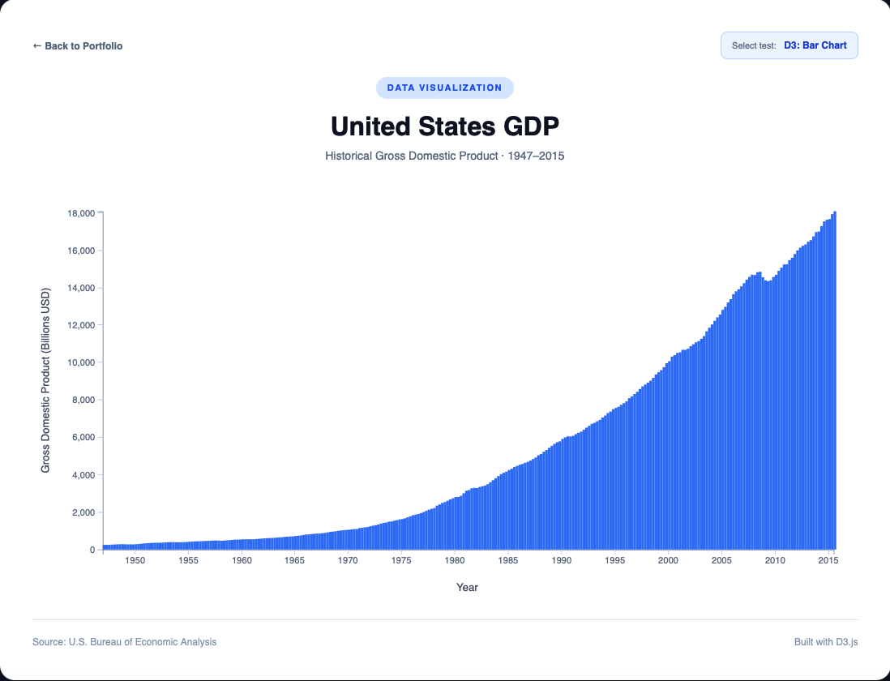
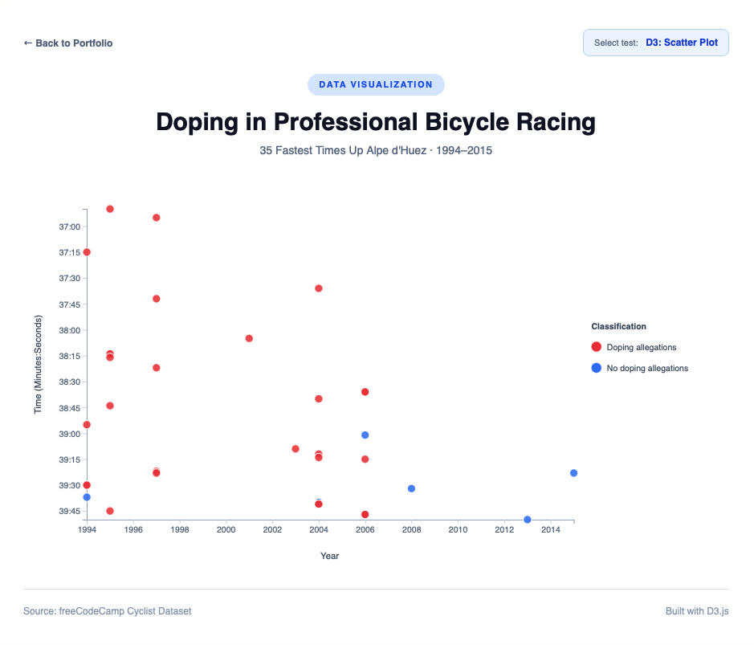
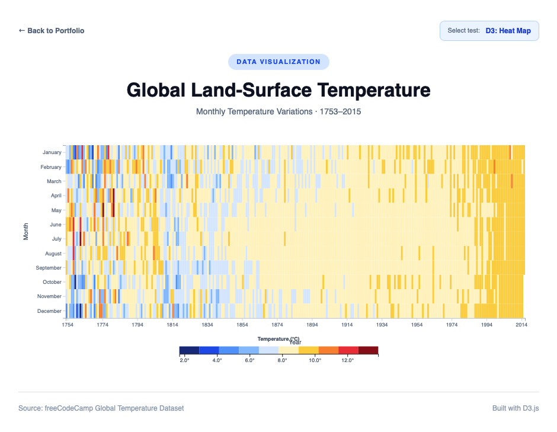
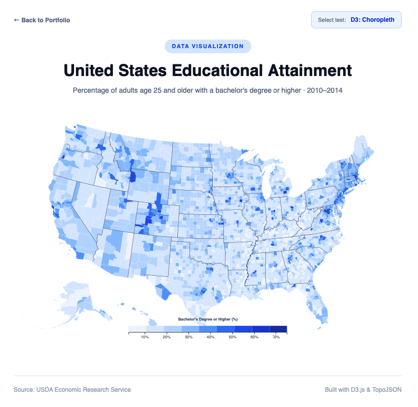
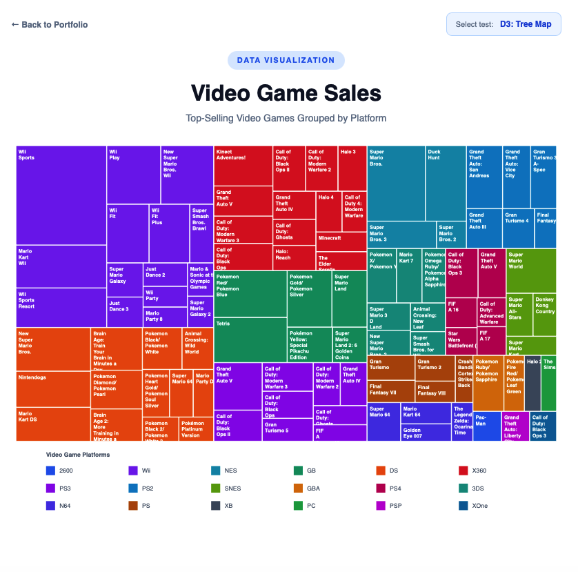

# 📊 Data Visualization with D3.js

### Data Science | Teclab × freeCodeCamp


---

## 📖 Project Overview

This repository contains the **five practical projects from the freeCodeCamp Data Visualization Certification**, developed as part of my academic training in the **Data Science Associate Degree Program at Teclab**.

The main objective is to apply data visualization concepts by developing interactive charts using **D3.js (Data-Driven Documents)**, JavaScript, HTML, and CSS.

Throughout these projects, different techniques are explored to represent, interpret, and communicate information from real-world datasets.

The visualizations cover several areas:

- Economic growth in the United States.
- Sports performance and historical data analysis.
- Global temperature variations.
- Geographic distribution of educational indicators.
- Video game sales and category analysis.

Each project was developed independently, implementing dynamic SVG visualizations, scales, interactions, and navigation components.

Additionally, a **main portfolio page was developed to centralize all five projects**, allowing users to access each visualization from a single interface.

---

## 🎓 Academic Context

| Information | Description |
|-------------|-------------|
| **Institution** | Teclab |
| **Degree Program** | Data Science Associate Degree |
| **Educational Platform** | freeCodeCamp |
| **Certification** | Data Visualization |
| **Field of Study** | Data Analysis and Visualization |
| **Main Library** | D3.js |
| **Programming Language** | JavaScript |
| **Number of Projects** | 5 |
| **Learning Approach** | Practical Development |

### Learning Objectives

The main objectives of these projects are:

1. Understand the fundamentals of data visualization.
2. Manipulate datasets using JavaScript.
3. Use D3.js to build dynamic visualizations.
4. Implement linear, temporal, and categorical scales.
5. Represent information using SVG elements.
6. Develop interactive charts with events and tooltips.
7. Interpret economic, sports, climate, and geographic data.
8. Apply hierarchical data visualization techniques.
9. Work with geographic data using TopoJSON.
10. Develop interfaces that facilitate data interpretation.

---

# 🌐 Interactive Portfolio

A main portfolio page was developed to provide access to all five projects through a single interface.

### 🚀 Explore the Portfolio

**[View Data Visualization Portfolio](https://melof10.github.io/data-visualization-v8/)**

The portfolio includes:

- Direct access to each visualization.
- A brief description of each project's objective.
- Identification of each visualization type.
- Information about the datasets used.
- Navigation between projects.
- Responsive design.
- Identification of the corresponding freeCodeCamp tests.

---

# 📁 Projects

## 1️⃣ Visualize Data with a Bar Chart

### 📊 United States GDP

**Objective:** Represent the historical evolution of the United States Gross Domestic Product (GDP) through an interactive bar chart.

This project visualizes U.S. economic growth over time using historical GDP data.

### Concepts Applied

- Bar charts with D3.js.
- Time scales.
- Linear scales.
- X and Y axes.
- JSON data manipulation.
- Dynamic SVG element generation.
- Interactive tooltips.
- Date and economic value formatting.

### Technologies

`JavaScript` `D3.js` `HTML5` `CSS3` `SVG`

### Preview



### 🔗 Interactive Visualization

**[View Bar Chart](https://melof10.github.io/data-visualization-v8/visualize-data-with-a-bar-chart/)**

**freeCodeCamp Test:** `D3: Bar Chart`

---

## 2️⃣ Visualize Data with a Scatterplot Graph

### 🚴 Doping in Professional Bicycle Racing

**Objective:** Analyze professional cyclists' performance through a scatterplot graph that relates recorded race times to competition years.

This project uses historical Alpe d'Huez climbing records, including information related to doping allegations.

The visualization helps identify patterns, performance differences, and potential relationships between variables.

### Concepts Applied

- Scatterplot graphs.
- Quantitative variable representation.
- Linear and temporal scales.
- SVG element positioning.
- Coordinate-based visualization.
- Color-based category differentiation.
- Legends.
- Interactive tooltips.
- Interpretation of relationships between variables.

### Technologies

`JavaScript` `D3.js` `HTML5` `CSS3` `SVG`

### Preview



### 🔗 Interactive Visualization

**[View Scatterplot Graph](https://melof10.github.io/data-visualization-v8/visualize-data-with-a-scatterplot-graph/)**

**freeCodeCamp Test:** `D3: Scatter Plot`

---

## 3️⃣ Visualize Data with a Heat Map

### 🌡️ Global Land-Surface Temperature

**Objective:** Represent historical global temperature variations through an interactive heat map.

This project uses monthly temperature records to identify warmer and colder periods across more than two centuries.

Color intensity and shades make it easier to interpret temperature variations and historical trends.

### Concepts Applied

- Heat maps.
- Time-series visualization.
- Color scales.
- Quantized scales.
- Matrix-based data representation.
- Temperature variation analysis.
- Temporal grouping by month and year.
- Temperature legends.
- Interactive tooltips.
- Visual interpretation of climate trends.

### Technologies

`JavaScript` `D3.js` `HTML5` `CSS3` `SVG`

### Preview



### 🔗 Interactive Visualization

**[View Heat Map](https://melof10.github.io/data-visualization-v8/visualize-data-with-a-heat-map/)**

**freeCodeCamp Test:** `D3: Heat Map`

---

## 4️⃣ Visualize Data with a Choropleth Map

### 🗺️ United States Educational Attainment

**Objective:** Visualize the geographic distribution of educational attainment across counties in the United States using a choropleth map.

This project represents the percentage of adults aged 25 and older who hold a bachelor's degree or higher.

Each county is identified by a FIPS code and represented using a color associated with its educational attainment indicator.

### Concepts Applied

- Geographic data visualization.
- Choropleth maps.
- Geospatial data.
- GeoJSON and TopoJSON.
- Geographic identification using FIPS codes.
- Geographic data transformation.
- Quantized color scales.
- SVG polygon representation.
- Dataset integration.
- Geographic tooltips.
- Spatial interpretation of social indicators.

### Technologies

`JavaScript` `D3.js` `TopoJSON` `HTML5` `CSS3` `SVG`

### Preview



### 🔗 Interactive Visualization

**[View Choropleth Map](https://melof10.github.io/data-visualization-v8/visualize-data-with-a-choropleth-map/)**

**freeCodeCamp Test:** `D3: Choropleth`

---

## 5️⃣ Visualize Data with a Treemap Diagram

### 🎮 Video Game Sales

**Objective:** Represent video game sales using a hierarchical diagram composed of proportional rectangles.

This project allows users to compare sales volumes across different video games and platforms through the size and color of each element.

Rectangles represent quantitative values, while colors identify different categories.

### Concepts Applied

- Hierarchical data visualization.
- Treemap diagrams.
- Hierarchical data structures.
- `d3.hierarchy()`.
- `d3.treemap()`.
- Ordinal scales.
- Proportional value representation.
- Category grouping.
- Spatial distribution of SVG elements.
- Categorical legends.
- Interactive tooltips.
- Visual comparison of magnitudes.

### Technologies

`JavaScript` `D3.js` `HTML5` `CSS3` `SVG`

### Preview



### 🔗 Interactive Visualization

**[View Treemap Diagram](https://melof10.github.io/data-visualization-v8/visualize-data-with-a-treemap-diagram/)**

**freeCodeCamp Test:** `D3: Tree Map`

---

# 🛠️ Technologies Used

| Technology | Application |
|------------|-------------|
| **JavaScript (ES6+)** | Data manipulation and visualization logic |
| **D3.js** | Interactive chart development |
| **HTML5** | Web page structure |
| **CSS3** | Visual design and responsive styling |
| **SVG** | Vector-based graphical representation |
| **TopoJSON** | Geographic data processing |
| **JSON** | Dataset format |
| **Git** | Version control |
| **GitHub** | Source code repository |
| **GitHub Pages** | Project deployment and hosting |

---

# 🧠 Applied Data Science Concepts

The development of these projects provided practical experience with fundamental concepts related to data analysis and communication.

### 📊 Data Visualization

Selecting appropriate graphical representations based on the characteristics of different datasets.

### 📈 Time-Series Analysis

Interpreting the evolution of economic and climate variables over time.

### 🔎 Relationship Analysis

Representing observations through scatterplots to identify patterns and potential associations between variables.

### 🌍 Geospatial Analysis

Representing geographic indicators using maps and spatial datasets.

### 🧩 Hierarchical Data Analysis

Organizing and proportionally representing categories and subcategories.

### 🎨 Visual Encoding

Using colors, positions, sizes, and shapes to communicate quantitative and categorical information.

### 🖱️ Interactivity

Implementing events and tooltips to enable dynamic data exploration.

---

# 🏗️ Repository Structure

```text
data-visualization-v8/
│
├── index.html
├── style.css
├── project-navigation.css
├── README.md
│
├── visualize-data-with-a-bar-chart/
│   ├── index.html
│   ├── style.css
│   ├── script.js
│   ├── bar-chart-preview.png
│   └── visualize-data-with-a-bar-chart.png
│
├── visualize-data-with-a-scatterplot-graph/
│   ├── index.html
│   ├── style.css
│   ├── script.js
│   └── visualize-data-with-a-scatterplot-graph.png
│
├── visualize-data-with-a-heat-map/
│   ├── index.html
│   ├── style.css
│   ├── script.js
│   └── visualize-data-with-a-heat-map.png
│
├── visualize-data-with-a-choropleth-map/
│   ├── index.html
│   ├── style.css
│   ├── script.js
│   └── visualize-data-with-a-choropleth-map.png
│
└── visualize-data-with-a-treemap-diagram/
    ├── index.html
    ├── style.css
    ├── script.js
    └── visualize-data-with-a-treemap-diagram.png
```

---

# 📂 Datasets

The projects use publicly available datasets provided by freeCodeCamp.

| Project | Dataset |
|---------|---------|
| Bar Chart | US Gross Domestic Product |
| Scatterplot | Cyclist Performance Data |
| Heat Map | Global Temperature Data |
| Choropleth | US Education & County Geographic Data |
| Treemap | Video Game Sales Data |

### Data Sources

**Bar Chart**

https://raw.githubusercontent.com/freeCodeCamp/ProjectReferenceData/master/GDP-data.json

**Scatterplot Graph**

https://raw.githubusercontent.com/freeCodeCamp/ProjectReferenceData/master/cyclist-data.json

**Heat Map**

https://raw.githubusercontent.com/freeCodeCamp/ProjectReferenceData/master/global-temperature.json

**Choropleth Map**

https://cdn.freecodecamp.org/testable-projects-fcc/data/choropleth_map/for_user_education.json

https://cdn.freecodecamp.org/testable-projects-fcc/data/choropleth_map/counties.json

**Treemap Diagram**

https://cdn.freecodecamp.org/testable-projects-fcc/data/tree_map/video-game-sales-data.json

---

# 🧪 Project Validation

Each project was developed according to the functional requirements established by freeCodeCamp.

The automated tests verify:

- Presence of required HTML elements.
- Correct data representation.
- SVG element generation.
- Correspondence between data values and graphical representations.
- Scale implementation.
- Colors and legends.
- Interactive behavior.
- Tooltip functionality.
- Required data attributes for each visualization.

Each project includes the official freeCodeCamp testing suite.

### Corresponding Tests

| Project | Test |
|---------|------|
| Bar Chart | `D3: Bar Chart` |
| Scatterplot Graph | `D3: Scatter Plot` |
| Heat Map | `D3: Heat Map` |
| Choropleth Map | `D3: Choropleth` |
| Treemap Diagram | `D3: Tree Map` |

> Each visualization includes an indication of the corresponding test to select in the freeCodeCamp testing panel.

---

# 🚀 Running the Projects Locally

### 1. Clone the Repository

```bash
git clone https://github.com/Melof10/data-visualization-v8.git
```

### 2. Navigate to the Project Directory

```bash
cd data-visualization-v8
```

### 3. Start a Local Server

Using Python:

```bash
python3 -m http.server 8000
```

### 4. Open the Browser

```text
http://localhost:8000
```

The main portfolio page provides access to all five visualizations.

> An Internet connection is required to load D3.js and the datasets used by the projects.

---

# 📚 Key Learnings

Throughout these projects, different approaches to transforming data into visual information were explored.

The main learning outcomes include:

- Understanding D3.js fundamentals.
- Building charts using SVG.
- Manipulating JSON data structures.
- Implementing scales and axes.
- Representing temporal data.
- Visualizing geographic information.
- Building hierarchical diagrams.
- Implementing interactive components.
- Interpreting different types of data visualizations.
- Organizing and deploying web projects.

These skills complement my academic training in **Data Science**, particularly in exploratory data analysis, data visualization, and communicating analytical results.

---

# 🎯 Conclusion

This repository brings together five practical projects focused on developing data visualization skills using D3.js.

Each project explores a different visualization technique, applying concepts related to temporal, quantitative, categorical, geographic, and hierarchical data.

The development of these visualizations is part of my academic training in the **Data Science Associate Degree Program at Teclab**, complemented by the practical challenges and educational content provided by **freeCodeCamp**.

The main goal is to strengthen the skills required to analyze, interpret, and communicate information through programming and data visualization tools.

---

## 🔗 Links

**Interactive Portfolio:**

https://melof10.github.io/data-visualization-v8/

**GitHub Repository:**

https://github.com/Melof10/data-visualization-v8

**freeCodeCamp:**

https://www.freecodecamp.org/

**Teclab:**

https://www.teclab.edu.ar/

---

**Developed as part of my academic training in Data Science at Teclab.**

*Practical projects based on the freeCodeCamp Data Visualization Certification.*